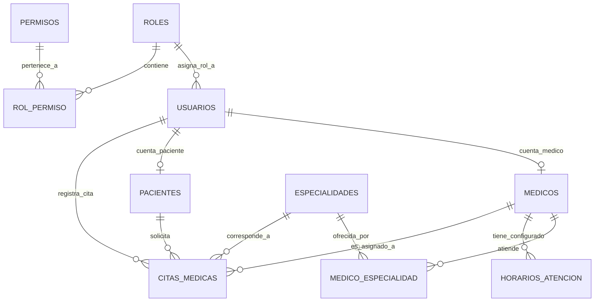
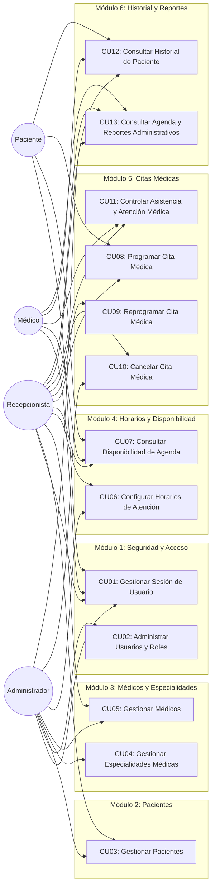
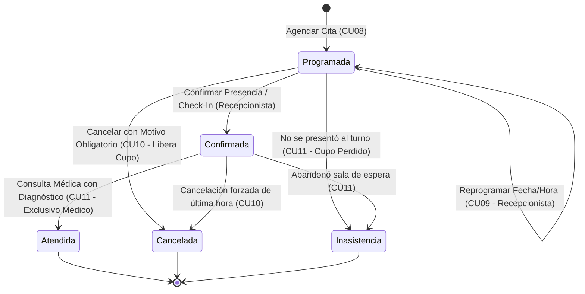
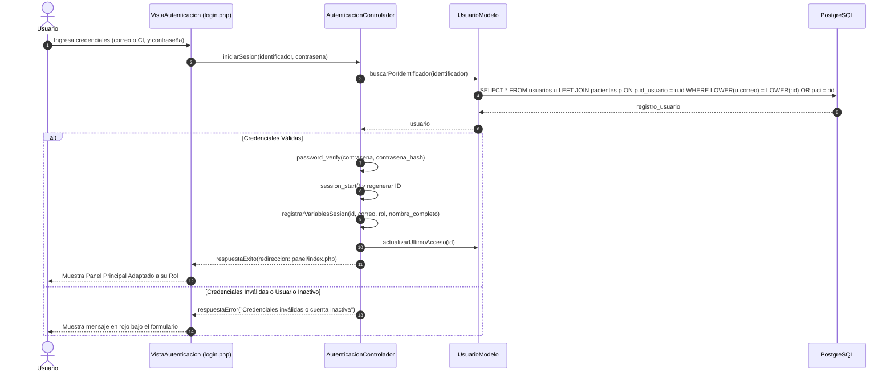
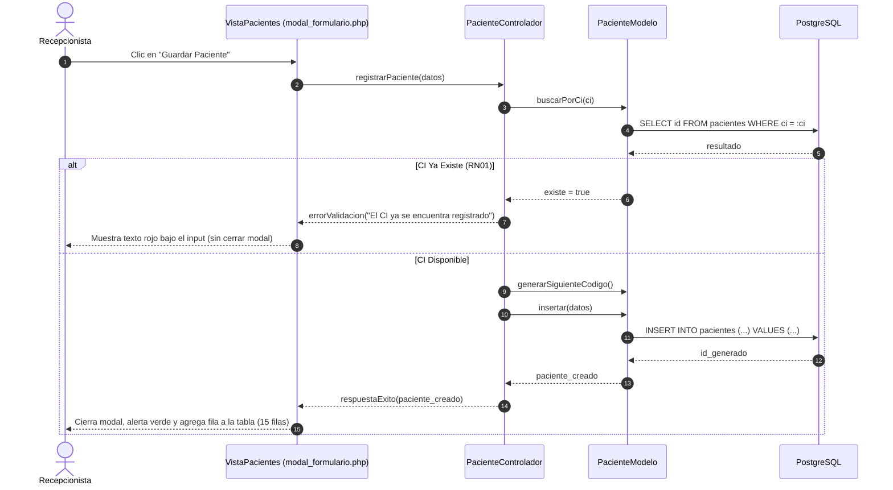
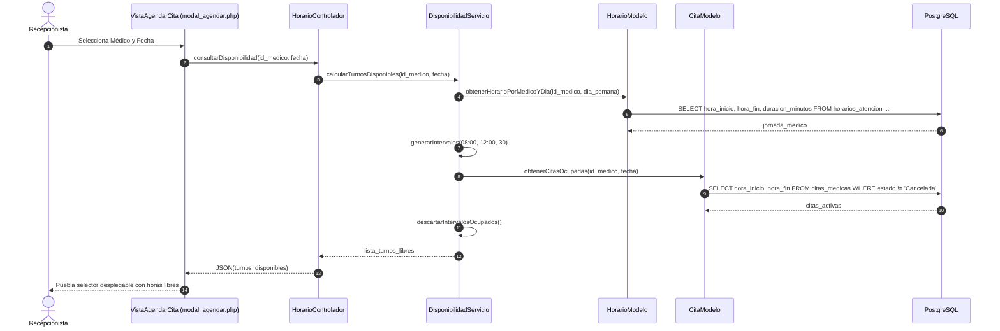
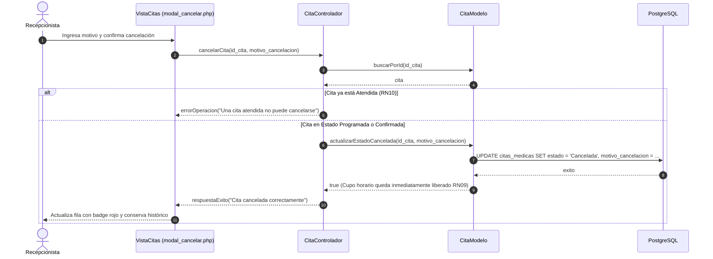

# PLAN MAESTRO DE IMPLEMENTACIÓN TÉCNICA - SISTEMA CLÍNICA VIDA SALUD

**Proyecto:** Sistema Web de Gestión de Citas Médicas para la "Clínica Vida Salud"  
**Materia:** Sistemas de Información 1 (SI1) – Carrera de Ingeniería Informática  
**Docente:** MSc. Ing. Angélica Gazón Cuéllar – UAGRM  
**Estudiante:** Jose Carlos  
**Metodología:** Proceso Unificado (PUDS) y Modelado UML 2.5 Formal  
**Arquitectura Global:** Arquitectura Web en 3 Capas (Presentación HTML5/CSS3/JS, Negocio en PHP con Control de Sesiones, y Datos con PostgreSQL mediante PDO `pdo_pgsql`)  
**Estructura de Casos de Uso:** Catálogo Formal de 13 Casos de Uso Orientados a Metas de Negocio (Sin fragmentación amateur de CRUDs individuales)  
**Convención Lingüística Estricta:** 100% en Español para Tablas, Columnas, Clases, Métodos y Rutas (Traza directa 1:1 con Diagramas de Secuencia y Comunicación PUDS)  
**Entorno de Ejecución Oficial de Evaluación:** Servidor Local Apache mediante XAMPP (Localhost) + SGBD PostgreSQL Local (Puerto 5432)  
**Entrega de Código:** Repositorio en GitHub con Código Organizado, Comentado y Código QR en Carátula

---

## ÍNDICE GENERAL DEL DOCUMENTO

1. [Alineación Estricta con los Requerimientos Técnicos del Examen (Sección 7)](#1-alineación-estricta-con-los-requerimientos-técnicos-del-examen-sección-7)
   - 1.1. Servidor Local Oficial: Apache mediante XAMPP en Localhost
   - 1.2. Conexión de Datos: PDO con el Controlador PostgreSQL `pdo_pgsql`
   - 1.3. Seguridad y Control de Acceso: Manejo Nativo de Sesiones PHP (`$_SESSION`)
   - 1.4. Prevención de Inyección SQL y Manejo Seguro de Errores
   - 1.5. Arquitectura en 3 Capas y Trazabilidad Directa con Diagramas UML
2. [Directrices Inviolables de UI/UX, Paleta Verde y Frontend Minimalista](#2-directrices-inviolables-de-uiux-paleta-verde-y-frontend-minimalista)
   - 2.1. Filosofía Minimalista: Cero Sobrecarga Visual y Sin Textos de Relleno
   - 2.2. Paleta Institucional Verde Hospital / Salud
   - 2.3. Regla Estricta: Cero Emojis y Librería Vectorial Bootstrap Icons
   - 2.4. Estándar de Paginación de 15 Filas y Acciones Estandarizadas por Fila
   - 2.5. Validaciones Dinámicas en Letras Rojas y Manejo de Modales
3. [Catálogo y Contratos de Componentes Compartidos (Frontend)](#3-catálogo-y-contratos-de-componentes-compartidos-frontend)
   - 3.1. Barra Lateral Reactiva según Rol en Sesión (`sidebar.php`)
   - 3.2. Barra Superior con Perfil y Cierre de Sesión (`topbar.php`)
   - 3.3. Paginación Compartida de 15 Registros (`paginacion.php`)
   - 3.4. Modal de Confirmación para Bajas Lógicas (`modal_confirmar.php`)
   - 3.5. Banners de Alerta y Notificación (`alerta.php`)
4. [Diseño Completo de la Base de Datos Relacional (PostgreSQL en Español)](#4-diseño-completo-de-la-base-de-datos-relacional-postgresql-en-español)
   - 4.1. Criterios de Nomenclatura en Español y Diferenciación Anti-Plagio
   - 4.2. Diccionario de Datos Completo (Tablas, Atributos, Tipos y Llaves)
   - 4.3. Diagrama Entidad-Relación y Cardinalidades
   - 4.4. Script DDL Oficial con Restricción Física GiST Anti-Solapamiento (RN07)
5. [Catálogo Oficial de Casos de Uso (UML 2.5 Formal - 13 Casos de Uso)](#5-catálogo-oficial-de-casos-de-uso-uml-25-formal---13-casos-de-uso)
   - 5.1. Justificación Metodológica: Eliminación del Anti-Patrón de Descomposición CRUD
   - 5.2. Matriz Exhaustiva de los 13 Casos de Uso del Sistema
   - 5.3. Diagrama General de Casos de Uso (UML 2.5)
   - 5.4. Ciclo de Vida y Máquina de Estados de Citas Médicas (Diferencia entre Cancelada e Inasistencia, Liberación de Cupos y Matriz RBAC)
6. [Trazabilidad PUDS-UML: Diagramas de Secuencia y Métodos en Español](#6-trazabilidad-puds-uml-diagramas-de-secuencia-y-métodos-en-español)
   - 6.1. Secuencia CU01: Gestionar Sesión de Usuario (`iniciarSesion`)
   - 6.2. Secuencia CU03: Gestionar Pacientes (`registrarPaciente`)
   - 6.3. Secuencia CU07: Consultar Disponibilidad de Agenda (`consultarDisponibilidad`)
   - 6.4. Secuencia CU08: Programar Cita Médica (`agendarCita`)
   - 6.5. Secuencia CU10: Cancelar Cita Médica (`cancelarCita`)
7. [Especificación Técnica Modular (Clases, Modelos y Controladores en Español)](#7-especificación-técnica-modular-clases-modelos-y-controladores-en-español)
   - 7.1. Módulo 1: Seguridad, Autenticación y Control de Acceso (CU01, CU02)
   - 7.2. Módulo 2: Gestión de Pacientes y Ficha Médica (CU03)
   - 7.3. Módulo 3: Especialidades Médicas y Plantel Médico (CU04, CU05)
   - 7.4. Módulo 4: Horarios de Atención y Disponibilidad de Agenda (CU06, CU07)
   - 7.5. Módulo 5: Programación, Reprogramación y Cancelación de Citas (CU08, CU09, CU10, CU11)
   - 7.6. Módulo 6: Historial Clínico, Agenda Médica y Reportes Administrativos (CU12, CU13)
8. [Estructura Exhaustiva de Carpetas y Archivos en Servidor Local](#8-estructura-exhaustiva-de-carpetas-y-archivos-en-servidor-local)
   - 8.1. Árbol de Directorios del Proyecto (`citas_medicas/` en XAMPP)
   - 8.2. Responsabilidad de Cada Archivo
9. [Seeder Coherente y Datos de Prueba Iniciales (Script SQL en Español)](#9-seeder-coherente-y-datos-de-prueba-iniciales-script-sql-en-español)
10. [Guía Paso a Paso de Instalación y Ejecución en Localhost (Apache / XAMPP)](#10-guía-paso-a-paso-de-instalación-y-ejecución-en-localhost-apache--xampp)
    - 10.1. Habilitación de `pdo_pgsql` en `php.ini`
    - 10.2. Creación y Carga de la Base de Datos en pgAdmin
    - 10.3. Configuración de Credenciales Locales
    - 10.4. Repositorio en GitHub y Generación del Código QR para la Carátula
11. [Guía Paso a Paso de Pruebas y Validación para la Defensa Presencial](#11-guía-paso-a-paso-de-pruebas-y-validación-para-la-defensa-presencial)
    - 11.1. Verificación de las 10 Pruebas Mínimas del Examen
    - 11.2. Guion de Demostración ante la Docente

---

## 1. ALINEACIÓN ESTRICTA CON LOS REQUERIMIENTOS TÉCNICOS DEL EXAMEN (SECCIÓN 7)

### 1.1. Servidor Local Oficial: Apache mediante XAMPP en Localhost
* **Exigencia Docente:** *"Servidor local: Apache mediante XAMPP compatible con la configuración elegida, o un entorno PHP equivalente."*
* **Implementación:** El proyecto se ejecuta en el servidor local de Jose Carlos (`C:/xampp/htdocs/citas_medicas/` en Windows o `/var/www/html/citas_medicas/` en Linux). La docente evaluará la aplicación abriendo el navegador en:
  `http://localhost/citas_medicas/`

### 1.2. Conexión de Datos: PDO con el Controlador PostgreSQL `pdo_pgsql`
* **Exigencia Docente:** *"Conexión: PDO con el controlador PostgreSQL pdo_pgsql, o una alternativa aprobada por el docente."*
* **Implementación:** Clase nativa `Conexion.php` en español (patrón Singleton):
  ```php
  <?php
  namespace App\core;
  use PDO;

  class Conexion {
      private static ?PDO $instancia = null;

      public static function obtenerConexion(): PDO {
          if (self::$instancia === null) {
              $dsn = "pgsql:host=" . BD_HOST . ";port=" . BD_PUERTO . ";dbname=" . BD_NOMBRE;
              self::$instancia = new PDO($dsn, BD_USUARIO, BD_CLAVE, [
                  PDO::ATTR_ERRMODE            => PDO::ERRMODE_EXCEPTION,
                  PDO::ATTR_DEFAULT_FETCH_MODE => PDO::FETCH_ASSOC,
                  PDO::ATTR_EMULATE_PREPARES   => false,
              ]);
          }
          return self::$instancia;
      }
  }
  ```

### 1.3. Seguridad y Control de Acceso: Manejo Nativo de Sesiones PHP (`$_SESSION`)
* **Exigencia Docente:** *"Uso de sesiones para controlar el acceso."* y *"RF01: Iniciar una sesión segura... Impedir el acceso a páginas internas cuando no exista una sesión válida."*
* **Implementación:**
  * Uso de `session_start()` al autenticar en `iniciarSesion()`.
  * Regeneración de identificador con `session_regenerate_id(true)`.
  * Variables de sesión en español:
    ```php
    $_SESSION['id_usuario']      = (int)$usuario['id'];
    $_SESSION['correo']          = $usuario['correo'];
    $_SESSION['nombre_completo'] = $usuario['nombres'] . ' ' . $usuario['apellidos'];
    $_SESSION['nombre_rol']      = $usuario['nombre_rol'];
    $_SESSION['id_paciente']     = $usuario['id_paciente'] ?? null;
    $_SESSION['id_medico']       = $usuario['id_medico'] ?? null;
    $_SESSION['autenticado']     = true;
    $_SESSION['ultimo_acceso']   = time();
    ```
  * Middleware de protección `GuardiaSesion.php`: Si `$_SESSION['autenticado']` no existe, se bloquea el acceso y se redirige inmediatamente a `login.php?error=acceso_denegado` (cumpliendo con la **Prueba 9** del examen).
  * Cierre seguro de sesión con `cerrarSesion()`: elimina variables con `session_unset()` y destruye la sesión con `session_destroy()`.

### 1.4. Prevención de Inyección SQL y Manejo Seguro de Errores
* **Exigencia Docente:** *"Consultas SQL parametrizadas para evitar inyección SQL."* y *"Manejo de errores sin mostrar credenciales ni detalles internos al usuario."*
* **Implementación:**
  * Prohibición absoluta de concatenación manual de cadenas en SQL. Se emplean exclusivamente sentencias preparadas:
    ```php
    $sentencia = $pdo->prepare("SELECT id, codigo, ci, nombres, apellidos FROM pacientes WHERE ci = :ci AND activo = TRUE");
    $sentencia->execute([':ci' => $ci]);
    $paciente = $sentencia->fetch();
    ```
  * Bloques `try / catch (\PDOException $e)` que capturan el fallo, escriben el detalle técnico en `almacenamiento/logs/errores.log` y muestran al usuario un mensaje amigable en pantalla sin exponer credenciales ni la estructura interna de la base de datos.

### 1.5. Arquitectura en 3 Capas y Trazabilidad Directa con Diagramas UML
* **Capa 1: Presentación (Vistas HTML5 / CSS3 / JS en `vistas/`):** Formularios compactos, tablas con paginación de 15 filas, validaciones en letras rojas bajo el input y llamadas asíncronas con JavaScript (Fetch API).
* **Capa 2: Lógica de Negocio (Controladores y Servicios en `src/Controladores/` y `src/Servicios/`):** Clases PHP que procesan las peticiones y aplican las 14 reglas de negocio (RN01 - RN14).
* **Capa 3: Acceso a Datos (Modelos en `src/Modelos/`):** Clases PHP que interactúan con PostgreSQL mediante PDO parametrizado.

---

## 2. DIRECTRICES INVIOLABLES DE UI/UX, PALETA VERDE Y FRONTEND MINIMALISTA

### 2.1. Filosofía Minimalista: Cero Sobrecarga Visual y Sin Textos de Relleno
* **Cero Párrafos Relleno:** Prohibido agregar bloques de texto explicativo innecesarios. Solo se muestran los títulos, tablas, filtros y modales funcionales.
* **Formularios Precisos:** Etiquetas claras (`<label>`), campos con placeholder discreto y botones de acción evidentes.
* **Tablas Limpias:** Bordes delgados (`#E2E8F0`), padding vertical compacto (`py-2`), filas alternadas sutiles y botones de acción directos.

### 2.2. Paleta Institucional Verde Hospital / Salud

| Elemento de Diseño | Nombre Semántico | Hexadecimal | Aplicación Visual |
| :--- | :--- | :--- | :--- |
| **Primario / Estructura** | Verde Bosque Médico | `#1B4332` | Barra de navegación superior, botones primarios, cabeceras |
| **Acento Activo** | Verde Esmeralda | `#2D6A4F` | Botones de confirmación, enlace activo en sidebar |
| **Fondo Base** | Blanco Clínico | `#FFFFFF` | Fondo de tarjetas, tablas, modales y campos de formulario |
| **Fondo Secundario** | Verde Pastel Tenue | `#F4F9F5` | Fondo general de toda la aplicación (`body`) |
| **Alerta / Éxito** | Menta Suave | `#D8F3DC` | Fondo de alertas de éxito y badges de cita `Atendida` |
| **Peligro / Validación** | Rojo Alerta | `#DC2626` | Letras de error bajo inputs inválidos (`.texto-error-campo`), botón cancelar |
| **Fondo Peligro Tenue** | Rosa Suave | `#FEF2F2` | Fondo de alertas de rechazo en modal y badges `Cancelada` |
| **Bordes y Divisores** | Gris Neutro | `#E2E8F0` | Líneas divisorias, bordes de tabla y bordes de input normal |
| **Texto Principal** | Grafito Oscuro | `#1E293B` | Encabezados, títulos de tabla y texto de lectura |
| **Texto Muted** | Gris Plomo | `#64748B` | Subtítulos, horas, notas de pie |

### 2.3. Regla Estricta: Cero Emojis y Librería Vectorial Bootstrap Icons
* **Prohibición Total:** Ningún emoji en vistas, títulos, mensajes ni botones.
* **Librería Oficial:** Exclusivamente **Bootstrap Icons** (`<i class="bi bi-*"></i>`):
  * Guardar / Confirmar: `<i class="bi bi-check2"></i>`
  * Editar registro: `<i class="bi bi-pencil"></i>`
  * Cancelar / Desactivar: `<i class="bi bi-trash3"></i>`
  * Ver Historial: `<i class="bi bi-clock-history"></i>`
  * Buscar: `<i class="bi bi-search"></i>`
  * Limpiar filtros: `<i class="bi bi-arrow-counterclockwise"></i>`
  * Nueva Cita / Nuevo Registro: `<i class="bi bi-plus-lg"></i>`
  * Calendario / Fecha: `<i class="bi bi-calendar3"></i>`
  * Horario / Reloj: `<i class="bi bi-clock"></i>`
  * Cerrar Sesión: `<i class="bi bi-box-arrow-right"></i>`

### 2.4. Estándar de Paginación de 15 Filas y Acciones Estandarizadas por Fila
1. **Paginación Uniforme:**
   * Todas las tablas (Pacientes, Médicos, Especialidades, Horarios, Citas, Usuarios) muestran **exactamente 15 filas por página**.
   * Los controles de paginación (`Anterior`, `Página X de Y`, `Siguiente`) se sitúan obligatoriamente en la **esquina inferior derecha**.
2. **Acciones por Fila:**
   * **Editar:** Botón con ícono `bi bi-pencil` (abre modal precargado).
   * **Desactivar / Cancelar:** Botón con ícono `bi bi-trash3` en tono rojo tenue. **Abre modal de confirmación; nunca elimina en silencio.**
   * **Historial (en Pacientes):** Botón con ícono `bi bi-clock-history` que lista las atenciones anteriores.

### 2.5. Validaciones Dinámicas en Letras Rojas y Manejo de Modales
* **Validación en el Cliente y Servidor:** Si un campo obligatorio está vacío o falla formato:
  * El texto explicativo aparece en **letras rojas institucionales (`#DC2626`)** debajo del campo (`.texto-error-campo`).
  * El input se resalta con borde rojo (`.campo-error`).
* **Regla Inviolable de Modales:** Si el servidor rechaza una operación:
  * **El modal NO debe cerrarse.**
  * Se muestra un banner rojo (`.alerta-modal-peligro`) en la parte superior del modal explicando el motivo exacto, permitiendo al usuario corregir la selección sin perder los datos previamente cargados.

---

## 3. CATÁLOGO Y CONTRATOS DE COMPONENTES COMPARTIDOS (FRONTEND)

### 3.1. Barra Lateral Reactiva según Rol en Sesión (`vistas/common/sidebar.php`)
* **Ubicación:** Lateral izquierdo fijo (`width: 250px`). Fondo Verde Bosque `#1B4332`.
* **Menú dinámico según `$_SESSION['nombre_rol']`:**
  * **Administrador:** Panel de Control, Usuarios, Pacientes, Médicos, Especialidades, Horarios, Citas, Reportes.
  * **Recepcionista:** Panel de Control, Pacientes, Médicos (consulta), Citas (agendar/reprogramar/cancelar/asistencia), Reportes.
  * **Médico:** Mi Agenda del Día, Registrar Atención, Historial de Pacientes.
  * **Paciente:** Mis Citas (consulta).

### 3.2. Barra Superior con Perfil y Cierre de Sesión (`vistas/common/topbar.php`)
* **Ubicación:** Superior fija. Fondo blanco `#FFFFFF`, borde `#E2E8F0`.
* **Contenido:** Logotipo con icono `bi bi-hospital` + texto *"Clínica Vida Salud"*. A la derecha: Nombre del usuario en sesión (`$_SESSION['nombre_completo']` o `$_SESSION['correo']`), badge de su rol institucional y botón de cierre de sesión con icono `bi bi-box-arrow-right`.

### 3.3. Paginación Compartida de 15 Registros (`vistas/common/paginacion.php`)
* Componente PHP reutilizable incluido al pie de cada tabla.
* Muestra el texto informativo a la izquierda (*"Mostrando 1 a 15 de 42 registros"*) y los botones a la derecha (*"« Anterior | Página 1 de 3 | Siguiente »"*).

### 3.4. Modal de Confirmación para Bajas Lógicas (`vistas/common/modal_confirmar.php`)
* Modal genérico accionado por JavaScript. Muestra advertencia clara: *"¿Está seguro de desactivar al registro [Nombre]? Sus citas y registros históricos no se eliminarán."* (Cumpliendo RN11).

### 3.5. Banners de Alerta y Notificación (`vistas/common/alerta.php`)
* Contenedor para mensajes de éxito (fondo menta `#D8F3DC`) o errores (fondo rosa tenue `#FEF2F2`).

---

## 4. DISEÑO COMPLETO DE LA BASE DE DATOS RELACIONAL (POSTGRESQL EN ESPAÑOL)

### 4.1. Criterios de Nomenclatura en Español y Diferenciación Anti-Plagio
* Todas las tablas están en plural en español (`roles`, `permisos`, `rol_permiso`, `usuarios`, `pacientes`, `medicos`, `especialidades`, `medico_especialidad`, `horarios_atencion`, `citas_medicas`).
* Todas las claves foráneas usan el prefijo `id_` seguido de la entidad (`id_rol`, `id_usuario`, `id_paciente`, `id_medico`, `id_especialidad`, `id_usuario_registro`).
* Todas las marcas temporales usan nombres en español: `fecha_creacion`, `fecha_actualizacion`, `ultimo_acceso`.
* Se implementa a nivel físico la restricción de no solapamiento mediante la extensión `btree_gist` con `EXCLUDE USING gist`, garantizando la regla RN07 en la base de datos.

### 4.2. Diccionario de Datos Completo

#### Tabla 1: `roles`
* `id`: `SERIAL`, PK.
* `nombre`: `VARCHAR(30)`, NOT NULL, Único (UK). (`'Administrador'`, `'Recepcionista'`, `'Medico'`, `'Paciente'`).
* `descripcion`: `VARCHAR(150)`, NULL.
* `activo`: `BOOLEAN`, NOT NULL, DEFAULT `TRUE`.

#### Tabla 2: `permisos`
* `id`: `SERIAL`, PK.
* `codigo_permiso`: `VARCHAR(60)`, NOT NULL, UK. Ej: `'pacientes.crear'`, `'citas.reprogramar'`.
* `descripcion`: `VARCHAR(120)`, NOT NULL.

#### Tabla 3: `rol_permiso`
* `id_rol`: `INT`, NOT NULL, FK -> `roles(id)` ON DELETE CASCADE.
* `id_permiso`: `INT`, NOT NULL, FK -> `permisos(id)` ON DELETE CASCADE.
* PK Compuesta: `(id_rol, id_permiso)`.

#### Tabla 4: `usuarios`
* `id`: `BIGSERIAL`, PK.
* `correo`: `VARCHAR(120)`, NOT NULL, UK (Credencial principal única para el inicio de sesión; no existe concepto de `nombre_usuario`).
* `contrasena_hash`: `VARCHAR(255)`, NOT NULL (Hash criptográfico generado con `password_hash()` de PHP mediante algoritmo Bcrypt).
* `id_rol`: `INT`, NOT NULL, FK -> `roles(id)` ON DELETE RESTRICT (1: Administrador, 2: Recepcionista, 3: Médico, 4: Paciente).
* `nombres`: `VARCHAR(80)`, NULL.
* `apellidos`: `VARCHAR(80)`, NULL.
* `telefono`: `VARCHAR(20)`, NULL (Validación de formato 7 a 10 dígitos numéricos).
* `activo`: `BOOLEAN`, NOT NULL, DEFAULT `TRUE`.
* `ultimo_acceso`: `TIMESTAMPTZ`, NULL.
* `fecha_creacion`: `TIMESTAMPTZ`, NOT NULL, DEFAULT `CURRENT_TIMESTAMP`.

#### Tabla 5: `especialidades`
* `id`: `SERIAL`, PK.
* `nombre`: `VARCHAR(100)`, NOT NULL, UK.
* `descripcion`: `TEXT`, NULL.
* `duracion_minutos`: `INT`, NOT NULL, DEFAULT `30`.
* `activa`: `BOOLEAN`, NOT NULL, DEFAULT `TRUE`.
* `fecha_creacion`: `TIMESTAMPTZ`, NOT NULL, DEFAULT `CURRENT_TIMESTAMP`.

#### Tabla 6: `medicos`
* `id`: `BIGSERIAL`, PK.
* `codigo`: `VARCHAR(20)`, NOT NULL, UK (`MED-001`).
* `registro_profesional`: `VARCHAR(40)`, NOT NULL, UK (Matrícula médica única - RN02).
* `nombres`: `VARCHAR(80)`, NOT NULL.
* `apellidos`: `VARCHAR(80)`, NOT NULL.
* `telefono`: `VARCHAR(20)`, NOT NULL.
* `correo`: `VARCHAR(120)`, NULL.
* `id_usuario`: `BIGINT`, NULL, UK, FK -> `usuarios(id)` ON DELETE SET NULL.
* `activo`: `BOOLEAN`, NOT NULL, DEFAULT `TRUE` (RN04, RN11).
* `fecha_creacion`: `TIMESTAMPTZ`, NOT NULL, DEFAULT `CURRENT_TIMESTAMP`.

#### Tabla 7: `medico_especialidad`
* `id_medico`: `BIGINT`, NOT NULL, FK -> `medicos(id)` ON DELETE RESTRICT.
* `id_especialidad`: `INT`, NOT NULL, FK -> `especialidades(id)` ON DELETE RESTRICT.
* PK Compuesta: `(id_medico, id_especialidad)`.

#### Tabla 8: `pacientes`
* `id`: `BIGSERIAL`, PK.
* `codigo`: `VARCHAR(20)`, NOT NULL, UK (`PAC-0001`).
* `ci`: `VARCHAR(20)`, NOT NULL, UK (Cédula de Identidad única - RN01).
* `nombres`: `VARCHAR(80)`, NOT NULL.
* `apellidos`: `VARCHAR(80)`, NOT NULL.
* `fecha_nacimiento`: `DATE`, NOT NULL.
* `sexo`: `CHAR(1)`, NOT NULL, CHECK (`sexo IN ('M', 'F', 'O')`).
* `telefono`: `VARCHAR(20)`, NOT NULL.
* `correo`: `VARCHAR(120)`, NULL.
* `direccion`: `VARCHAR(200)`, NULL.
* `contacto_emergencia_nombre`: `VARCHAR(100)`, NULL.
* `contacto_emergencia_telefono`: `VARCHAR(20)`, NULL.
* `id_usuario`: `BIGINT`, NULL, UK, FK -> `usuarios(id)` ON DELETE SET NULL.
* `activo`: `BOOLEAN`, NOT NULL, DEFAULT `TRUE` (RN11).
* `fecha_creacion`: `TIMESTAMPTZ`, NOT NULL, DEFAULT `CURRENT_TIMESTAMP`.

#### Tabla 9: `horarios_atencion`
* `id`: `BIGSERIAL`, PK.
* `id_medico`: `BIGINT`, NOT NULL, FK -> `medicos(id)` ON DELETE CASCADE.
* `dia_semana`: `SMALLINT`, NOT NULL, CHECK (`dia_semana BETWEEN 1 AND 7`) (1=Lunes, 7=Domingo).
* `hora_inicio`: `TIME`, NOT NULL.
* `hora_fin`: `TIME`, NOT NULL, CHECK (`hora_fin > hora_inicio`).
* `duracion_minutos`: `INT`, NOT NULL, DEFAULT `30` (RN08).
* `activo`: `BOOLEAN`, NOT NULL, DEFAULT `TRUE`.
* Restricción Única: `(id_medico, dia_semana, hora_inicio)`.

#### Tabla 10: `citas_medicas`
* `id`: `BIGSERIAL`, PK.
* `codigo_cita`: `VARCHAR(20)`, NOT NULL, UK (`CM-2026-0001`).
* `id_paciente`: `BIGINT`, NOT NULL, FK -> `pacientes(id)` ON DELETE RESTRICT (RN03).
* `id_medico`: `BIGINT`, NOT NULL, FK -> `medicos(id)` ON DELETE RESTRICT (RN03, RN04).
* `id_especialidad`: `INT`, NOT NULL, FK -> `especialidades(id)` ON DELETE RESTRICT.
* `fecha`: `DATE`, NOT NULL (RN06: `fecha >= CURRENT_DATE` al programar).
* `hora_inicio`: `TIME`, NOT NULL.
* `hora_fin`: `TIME`, NOT NULL, CHECK (`hora_fin > hora_inicio`).
* `motivo_consulta`: `VARCHAR(250)`, NULL.
* `estado`: `VARCHAR(20)`, NOT NULL, DEFAULT `'Programada'`, CHECK (`estado IN ('Programada', 'Confirmada', 'Atendida', 'Cancelada', 'Inasistencia')`).
* `motivo_cancelacion`: `VARCHAR(250)`, NULL (Obligatorio si estado = `'Cancelada'`, RN09).
* `observaciones_atencion`: `TEXT`, NULL (Comentarios clínicos del médico al atender).
* `id_usuario_registro`: `BIGINT`, NOT NULL, FK -> `usuarios(id)` ON DELETE RESTRICT.
* `fecha_creacion`: `TIMESTAMPTZ`, NOT NULL, DEFAULT `CURRENT_TIMESTAMP`.
* `fecha_actualizacion`: `TIMESTAMPTZ`, NOT NULL, DEFAULT `CURRENT_TIMESTAMP`.

### 4.3. Diagrama Entidad-Relación y Cardinalidades



### 4.4. Script DDL Oficial con Restricción Física GiST Anti-Solapamiento

```sql
-- ============================================================
-- BASE DE DATOS: CLINICA VIDA SALUD (SISTEMAS 1 - UAGRM)
-- Motor: PostgreSQL 15+ en Localhost
-- Estudiante: Jose Carlos
-- Nomenclatura: 100% en Español
-- ============================================================

BEGIN;

CREATE EXTENSION IF NOT EXISTS btree_gist;

CREATE TABLE roles (
    id SERIAL PRIMARY KEY,
    nombre VARCHAR(30) NOT NULL UNIQUE,
    descripcion VARCHAR(150),
    activo BOOLEAN NOT NULL DEFAULT TRUE
);

CREATE TABLE permisos (
    id SERIAL PRIMARY KEY,
    codigo_permiso VARCHAR(60) NOT NULL UNIQUE,
    descripcion VARCHAR(120) NOT NULL
);

CREATE TABLE rol_permiso (
    id_rol INT NOT NULL REFERENCES roles(id) ON DELETE CASCADE,
    id_permiso INT NOT NULL REFERENCES permisos(id) ON DELETE CASCADE,
    PRIMARY KEY (id_rol, id_permiso)
);

CREATE TABLE usuarios (
    id BIGSERIAL PRIMARY KEY,
    correo VARCHAR(120) NOT NULL UNIQUE,
    contrasena_hash VARCHAR(255) NOT NULL,
    id_rol INT NOT NULL REFERENCES roles(id) ON DELETE RESTRICT,
    nombres VARCHAR(80),
    apellidos VARCHAR(80),
    telefono VARCHAR(20),
    activo BOOLEAN NOT NULL DEFAULT TRUE,
    ultimo_acceso TIMESTAMPTZ,
    fecha_creacion TIMESTAMPTZ NOT NULL DEFAULT CURRENT_TIMESTAMP
);

CREATE TABLE especialidades (
    id SERIAL PRIMARY KEY,
    nombre VARCHAR(100) NOT NULL UNIQUE,
    descripcion TEXT,
    duracion_minutos INT NOT NULL DEFAULT 30 CHECK (duracion_minutos > 0),
    activa BOOLEAN NOT NULL DEFAULT TRUE,
    fecha_creacion TIMESTAMPTZ NOT NULL DEFAULT CURRENT_TIMESTAMP
);

CREATE TABLE medicos (
    id BIGSERIAL PRIMARY KEY,
    codigo VARCHAR(20) NOT NULL UNIQUE,
    registro_profesional VARCHAR(40) NOT NULL UNIQUE,
    nombres VARCHAR(80) NOT NULL,
    apellidos VARCHAR(80) NOT NULL,
    telefono VARCHAR(20) NOT NULL,
    correo VARCHAR(120),
    id_usuario BIGINT UNIQUE REFERENCES usuarios(id) ON DELETE SET NULL,
    activo BOOLEAN NOT NULL DEFAULT TRUE,
    fecha_creacion TIMESTAMPTZ NOT NULL DEFAULT CURRENT_TIMESTAMP
);

CREATE INDEX idx_medicos_apellidos_nombres ON medicos(apellidos, nombres);

CREATE TABLE medico_especialidad (
    id_medico BIGINT NOT NULL REFERENCES medicos(id) ON DELETE RESTRICT,
    id_especialidad INT NOT NULL REFERENCES especialidades(id) ON DELETE RESTRICT,
    PRIMARY KEY (id_medico, id_especialidad)
);

CREATE TABLE pacientes (
    id BIGSERIAL PRIMARY KEY,
    codigo VARCHAR(20) NOT NULL UNIQUE,
    ci VARCHAR(20) NOT NULL UNIQUE,
    nombres VARCHAR(80) NOT NULL,
    apellidos VARCHAR(80) NOT NULL,
    fecha_nacimiento DATE NOT NULL,
    sexo CHAR(1) NOT NULL CHECK (sexo IN ('M', 'F', 'O')),
    telefono VARCHAR(20) NOT NULL,
    correo VARCHAR(120),
    direccion VARCHAR(200),
    contacto_emergencia_nombre VARCHAR(100),
    contacto_emergencia_telefono VARCHAR(20),
    id_usuario BIGINT UNIQUE REFERENCES usuarios(id) ON DELETE SET NULL,
    activo BOOLEAN NOT NULL DEFAULT TRUE,
    fecha_creacion TIMESTAMPTZ NOT NULL DEFAULT CURRENT_TIMESTAMP
);

CREATE INDEX idx_pacientes_ci ON pacientes(ci);
CREATE INDEX idx_pacientes_apellidos_nombres ON pacientes(apellidos, nombres);

CREATE TABLE horarios_atencion (
    id BIGSERIAL PRIMARY KEY,
    id_medico BIGINT NOT NULL REFERENCES medicos(id) ON DELETE CASCADE,
    dia_semana SMALLINT NOT NULL CHECK (dia_semana BETWEEN 1 AND 7),
    hora_inicio TIME NOT NULL,
    hora_fin TIME NOT NULL,
    duracion_minutos INT NOT NULL DEFAULT 30 CHECK (duracion_minutos > 0),
    activo BOOLEAN NOT NULL DEFAULT TRUE,
    CONSTRAINT chk_rango_horario CHECK (hora_fin > hora_inicio),
    CONSTRAINT uq_medico_dia_hora UNIQUE (id_medico, dia_semana, hora_inicio)
);

CREATE TABLE citas_medicas (
    id BIGSERIAL PRIMARY KEY,
    codigo_cita VARCHAR(20) NOT NULL UNIQUE,
    id_paciente BIGINT NOT NULL REFERENCES pacientes(id) ON DELETE RESTRICT,
    id_medico BIGINT NOT NULL REFERENCES medicos(id) ON DELETE RESTRICT,
    id_especialidad INT NOT NULL REFERENCES especialidades(id) ON DELETE RESTRICT,
    fecha DATE NOT NULL,
    hora_inicio TIME NOT NULL,
    hora_fin TIME NOT NULL,
    motivo_consulta VARCHAR(250),
    estado VARCHAR(20) NOT NULL DEFAULT 'Programada' 
        CHECK (estado IN ('Programada', 'Confirmada', 'Atendida', 'Cancelada', 'Inasistencia')),
    motivo_cancelacion VARCHAR(250),
    observaciones_atencion TEXT,
    id_usuario_registro BIGINT NOT NULL REFERENCES usuarios(id) ON DELETE RESTRICT,
    fecha_creacion TIMESTAMPTZ NOT NULL DEFAULT CURRENT_TIMESTAMP,
    fecha_actualizacion TIMESTAMPTZ NOT NULL DEFAULT CURRENT_TIMESTAMP,
    CONSTRAINT chk_horas_cita CHECK (hora_fin > hora_inicio)
);

ALTER TABLE citas_medicas
    ADD CONSTRAINT ex_cita_medico_no_solapada
    EXCLUDE USING gist (
        id_medico WITH =,
        tsrange(fecha + hora_inicio, fecha + hora_fin, '[)') WITH &&
    )
    WHERE (estado <> 'Cancelada');

CREATE INDEX idx_citas_fecha_estado ON citas_medicas(fecha, estado);
CREATE INDEX idx_citas_paciente ON citas_medicas(id_paciente, fecha DESC);
CREATE INDEX idx_citas_medico_fecha ON citas_medicas(id_medico, fecha);

CREATE OR REPLACE VIEW vista_citas_completas AS
SELECT 
    c.id,
    c.codigo_cita,
    c.fecha,
    c.hora_inicio,
    c.hora_fin,
    c.estado,
    c.motivo_consulta,
    c.motivo_cancelacion,
    c.observaciones_atencion,
    p.codigo AS codigo_paciente,
    p.ci AS ci_paciente,
    (p.nombres || ' ' || p.apellidos) AS nombre_completo_paciente,
    p.telefono AS telefono_paciente,
    m.codigo AS codigo_medico,
    (m.nombres || ' ' || m.apellidos) AS nombre_completo_medico,
    m.registro_profesional AS matricula_medico,
    e.nombre AS nombre_especialidad,
    u.correo AS registrado_por
FROM citas_medicas c
JOIN pacientes p ON p.id = c.id_paciente
JOIN medicos m ON m.id = c.id_medico
JOIN especialidades e ON e.id = c.id_especialidad
JOIN usuarios u ON u.id = c.id_usuario_registro;

COMMIT;
```

---

## 5. CATÁLOGO OFICIAL DE CASOS DE USO (UML 2.5 FORMAL - 13 CASOS DE USO)

### 5.1. Justificación Metodológica: Eliminación del Anti-Patrón de Descomposición CRUD
En la ingeniería de software profesional bajo el estándar **UML 2.5** y el **Proceso Unificado de Desarrollo de Software (PUDS)**:
* Un Caso de Uso representa una **secuencia completa de acciones orientada a un objetivo de negocio que entrega un resultado de valor observable a un actor**.
* Descomponer un CRUD en cuatro casos de uso aislados (*"Crear Paciente"*, *"Editar Paciente"*, *"Eliminar Paciente"*, *"Buscar Paciente"*) o separar *"Iniciar Sesión"* de *"Cerrar Sesión"* constituye un **anti-patrón de descomposición funcional amateur**.
* Por lo tanto, el sistema se estructura formalmente en **13 Casos de Uso cohesivos**, cubriendo el 100% del alcance del examen de la Ing. Angélica Gazón Cuéllar:

### 5.2. Matriz Exhaustiva de los 13 Casos de Uso del Sistema

| Identificador | Nombre del Caso de Uso | Actores Participantes | Propósito y Alcance del Caso de Uso | Reglas de Negocio Asociadas |
| :---: | :--- | :--- | :--- | :--- |
| **`CU01`** | **Gestionar Sesión de Usuario** | Administrador, Recepcionista, Médico, Paciente | Control del ciclo de vida de la sesión: validación de credenciales con `password_verify()`, regeneración de ID de sesión, control de inactividad, cierre seguro de sesión y redirección por falta de sesión válida. | RN12 |
| **`CU02`** | **Administrar Usuarios y Roles** | Administrador | Administración de cuentas de operadores: creación de usuarios, asignación de roles RBAC (`Administrador`, `Recepcionista`, `Medico`, `Paciente`), modificación y baja lógica. | RN12 |
| **`CU03`** | **Gestionar Pacientes** | Recepcionista, Administrador | Gestión integral de pacientes: registro con código `PAC-XXXX`, validación de CI único, búsqueda ágil por documento o apellido, edición de datos de contacto y baja lógica sin perder histórico. | RN01, RN11 |
| **`CU04`** | **Gestionar Especialidades Médicas** | Administrador | Catálogo de especialidades ofrecidas: alta con nombre normalizado único, descripción, asignación de duración por defecto (30 min) y desactivación. | RN08 |
| **`CU05`** | **Gestionar Médicos**   | Administrador, Recepcionista (consulta) | Mantenimiento del plantel profesional: registro con código `MED-XXX`, matrícula médica única, asignación de especialidades y baja lógica conservando citas. | RN02, RN04, RN11 |
| **`CU06`** | **Configurar Horarios de Atención** | Administrador, Recepcionista | Definición de las jornadas semanales por médico: días de atención (1-7), hora de inicio, hora de fin y duración de consulta (30 min). | RN05, RN08 |
| **`CU07`** | **Consultar Disponibilidad de Agenda** | Recepcionista, Médico, Paciente | Motor de cálculo de turnos libres: cruza la jornada configurada con las citas existentes y descarta citas activas y fechas pasadas, devolviendo los bloques libres de 30 min. | RN05, RN06, RN07, RN09 |
| **`CU08`** | **Programar Cita Médica** | Recepcionista, Paciente | Núcleo de agendamiento: selección de paciente, médico, fecha y turno libre, validación de reglas de negocio y confirmación transaccional con código correlativo `CM-XXXX`. | RN03, RN04, RN05, RN06, RN07, RN08, RN13, RN14 |
| **`CU09`** | **Reprogramar Cita Médica** | Recepcionista | Modificación justificada de fecha y horario de una cita programada o confirmada, verificando la nueva disponibilidad y bloqueando la acción en citas atendidas/canceladas. | RN05, RN06, RN07, RN13 |
| **`CU10`** | **Cancelar Cita Médica** | Recepcionista, Administrador | Cancelación formal de una cita reservada con ingreso obligatorio del motivo de cancelación, actualización de estado a `Cancelada` y **liberación inmediata del cupo horario**. | RN09, RN10 |
| **`CU11`** | **Controlar Asistencia y Atención Médica** | Médico, Recepcionista | Ciclo de ejecución de la cita: marcar confirmación presencial del paciente, registro de consulta realizada (`Atendida`) con notas clínicas o registro de inasistencia. | RN10, RN12 |
| **`CU12`** | **Consultar Historial de Paciente** | Médico, Recepcionista, Paciente | Consulta cronológica de los antecedentes de atenciones de un paciente: historial de citas pasadas, canceladas con motivo y citas atendidas con diagnóstico. | RN10 |
| **`CU13`** | **Consultar Agenda y Reportes Administrativos** | Administrador, Médico, Recepcionista | Visualización de la agenda diaria del médico y generación de reportes gerenciales con filtros por período, médico, especialidad y estado, con totales automáticos y exportación CSV. | RN10, RN12 |

### 5.3. Diagrama General de Casos de Uso (UML 2.5)



### 5.4. Ciclo de Vida y Máquina de Estados de Citas Médicas (UML 2.5 State Machine)

Para cumplir con los más rigurosos estándares de modelado hospitalario y arquitectura de software (Sistemas de Información 1 - UAGRM), el flujo de estados de una cita médica está desacoplado con precisión clínica, delimitando qué acciones corresponden a recepción y cuáles son exclusivas del profesional médico:

#### 1. Tabla Comparativa de Estados: Definición, Actores y Efecto en la Agenda

| Estado de la Cita | Significado Clínico / Operativo | Actores Autorizados | Acciones Permitidas | Efecto sobre la Agenda (Liberación de Cupo) |
| :--- | :--- | :--- | :--- | :--- |
| **`Programada`** | Reserva inicial de un cupo horario a futuro realizada por el paciente o ventanilla de recepción. | Paciente, Recepcionista | • Confirmar Asistencia presencial<br>• Reprogramar fecha/hora<br>• Cancelar con motivo obligatorio<br>• Marcar Inasistencia (si expiró el turno) | **Cupo Reservado (Ocupado).** Protegido contra colisiones concurrentes por la restricción física `GiST` en PostgreSQL. |
| **`Confirmada`** | **Check-In en Recepción:** El paciente se apersonó a la clínica o confirmó telefónicamente; se encuentra físicamente aguardando en la sala de espera. *(No equivale a "Atendida")*. | Recepcionista | • Marcar Atención (Exclusivo Médico)<br>• Marcar Inasistencia (si abandona sala)<br>• Cancelar con motivo obligatorio<br>*(No admite reprogramación directa)* | **Cupo Bloqueado.** El médico visualiza en su tablero que el paciente está en sala de espera listo para ser llamado a consulta. |
| **`Atendida`** | **Consulta Médica Realizada:** El médico ingresó al paciente al consultorio, ejecutó la evaluación clínica y registró notas diagnósticas obligatorias. Estado terminal definitivo. | **Únicamente Médico** | • Ninguna (Estado de sólo lectura histórico)<br>• Alimenta formalmente el Historial Clínico | **Cupo Consumido Satisfactoriamente.** No puede cancelarse, reprogramarse ni borrarse (RN10). |
| **`Cancelada`** | **Anulación Anticipada con Justificación:** El paciente o la clínica cancelan la cita *antes* de la consulta, especificando obligatoriamente el motivo de cancelación. | Recepcionista, Administrador | • Ninguna (Estado terminal histórico)<br>• Registro permanente para auditoría | **CUPO LIBERADO INMEDIATAMENTE (RN09).** La cláusula `WHERE estado <> 'Cancelada'` del índice `GiST` libera el turno de inmediato para que otro paciente pueda reservarlo. |
| **`Inasistencia`** | **No-Show (Ausencia del Paciente):** El paciente nunca se presentó a su turno o llegó después de transcurrido el horario (incluso habiendo confirmado previamente). | Recepcionista, Médico | • Ninguna (Estado terminal de penalización)<br>• Computado en el reporte de absentismo del paciente | **CUPO NO LIBERADO (HORA MÉDICA PERDIDA).** Como el horario ya transcurrió en el pasado, el turno médico se perdió irreversiblemente (tiempo ocioso médico no recuperable). |

#### 2. Diferencia Conceptual y Operativa: ¿Por qué «Cancelada» e «Inasistencia» NO son lo mismo?

1. **Momento Temporal y Notificación:**
   - **`Cancelada`:** Existe una comunicación previa (vía telefónica o presencial) antes o durante la jornada donde el paciente o la clínica notifican la imposibilidad de asistir con un **motivo obligatorio registrado**.
   - **`Inasistencia`:** No existe comunicación o el aviso llega extemporáneamente. El médico estuvo físicamente disponible en su consultorio durante todo el bloque horario aguardando la llegada del paciente.

2. **Impacto en la Capacidad Operativa y Teoría de Colas:**
   - **`Cancelada`:** **Recupera capacidad médica.** Al liberarse el turno inmediatamente, el motor de disponibilidad lo ofrece de nuevo, permitiendo a pacientes en ventanilla o en lista de espera aprovechar el espacio.
   - **`Inasistencia`:** **Destruye capacidad médica.** Representa una hora médica perdida (costo ocioso de infraestructura y personal). No puede ser reasignada porque la hora ya transcurrió.

3. **Comportamiento en la Persistencia Física (PostgreSQL - GiST):**
   - En `Cancelada`: El índice GiST (`EXCLUDE USING gist`) ignora el registro gracias a su condición parcial `WHERE estado <> 'Cancelada'`, habilitando nuevamente el rango temporal `[fecha + hora_inicio, fecha + hora_fin)` para nuevas inserciones.
   - En `Inasistencia`: El registro mantiene bloqueado el rango histórico en la base de datos y se acumula en los reportes gerenciales para auditar el índice de absentismo del padrón de pacientes.

#### 3. Diagrama de Transición de Estados (UML 2.5 State Machine)



#### 4. Matriz de Control de Acceso por Rol (RBAC) para Citas Médicas

| Operación / Acción | Administrador | Recepcionista | Médico | Paciente |
| :--- | :---: | :---: | :---: | :---: |
| **Ver Citas** | Todas | Todas | Solo las de su consultorio | Solo sus citas personales |
| **Agendar Cita** | Sí (Supervisión) | Sí (Ventanilla) | No (Competencia de recepción) | Sí (Autoservicio) |
| **Confirmar Asistencia (Check-In)** | Sí | Sí (En ventanilla) | No | No |
| **Reprogramar Cita** | Sí (Solo en `Programada`) | Sí (Solo en `Programada`) | No | No |
| **Atender Cita (Notas Clínicas)** | Sí (Supervisión) | **PROHIBIDO** | **SÍ (Exclusivo)** | No |
| **Registrar Inasistencia** | Sí | Sí | Sí | No |
| **Cancelar Cita (con motivo)** | Sí | Sí | No | Sí (Solo sus citas pendientes) |

---

## 6. TRAZABILIDAD PUDS-UML: DIAGRAMAS DE SECUENCIA Y MÉTODOS EN ESPAÑOL

### 6.1. Secuencia CU01: Gestionar Sesión de Usuario (`iniciarSesion`)



### 6.2. Secuencia CU03: Gestionar Pacientes (`registrarPaciente`)



### 6.3. Secuencia CU07: Consultar Disponibilidad de Agenda (`consultarDisponibilidad`)



### 6.4. Secuencia CU08: Programar Cita Médica (`agendarCita`)

```mermaid
sequenceDiagram
    autonumber
    actor Recepcionista
    participant V as VistaAgendarCita (modal_agendar.php)
    participant C as CitaControlador
    participant S as CitaValidacionServicio
    participant CM as CitaModelo
    participant BD as PostgreSQL

    Recepcionista->>V: Clic en "Confirmar Cita"
    V->>C: agendarCita(datos_cita)
    C->>S: validarReglasAgendamiento(datos_cita)
    S->>S: validarFechaNoPasada(fecha) (RN06)
    S->>S: validarMedicoActivo(id_medico) (RN04)
    alt Conflicto de Disponibilidad (RN07)
        S->>CM: verificarConflictoHorario(id_medico, fecha, hora_inicio, hora_fin)
        CM->>BD: SELECT COUNT(*) FROM citas_medicas WHERE ...
        BD-->>CM: total_conflictos > 0
        CM-->>S: conflicto = true
        S-->>C: Error("El horario seleccionado ya no está disponible")
        C-->>V: errorRespuesta(mensaje)
        V-->>Recepcionista: Muestra alerta roja en cabecera del modal (modal abierto)
    else Horario Libre y Válido
        C->>CM: insertarTransaccional(datos_cita)
        CM->>BD: BEGIN; INSERT INTO citas_medicas (...); COMMIT;
        BD-->>CM: codigo_cita CM-2026-0004
        CM-->>C: cita_creada
        C-->>V: exitoRespuesta(cita_creada)
        V-->>Recepcionista: Cierra modal, alerta verde y actualiza tabla
    end
```

### 6.5. Secuencia CU10: Cancelar Cita Médica (`cancelarCita`)



---

## 7. ESPECIFICACIÓN TÉCNICA MODULAR (CLASES, MODELOS Y CONTROLADORES EN ESPAÑOL)

A continuación se detalla la signatura exacta de clases y métodos implementados en la Capa de Negocio y Datos, agrupados por caso de uso:

### 7.1. Módulo 1: Seguridad, Autenticación y Control de Acceso (CU01, CU02)
* **Credenciales Estrictas (Sin `nombre_usuario`):** El acceso se gestiona de manera única y transparente a través de `correo` y `contrasena` (encriptada con `password_hash()` de Bcrypt). Para los pacientes, el sistema permite alternativamente el ingreso con su número de `ci` y contraseña. No existe ningún campo ni concepto de `nombre_usuario` en la base de datos ni en el código.
* **Controlador:** `App\Controladores\AutenticacionControlador`
  * `iniciarSesion(string $identificador, string $contrasena): array`: Autentica credenciales, regenera ID de sesión y setea variables en `$_SESSION` (`id_usuario`, `correo`, `nombre_completo`, `id_rol`, `nombre_rol`, `id_paciente`, `id_medico`). Redirige siempre al panel personalizado según rol (`/vistas/panel/index.php`).
  * `cerrarSesion(): void`
  * `obtenerUsuarioActual(): ?array`
* **Controlador:** `App\Controladores\UsuarioControlador`
  * `listarUsuarios(int $pagina = 1, string $buscar = '', int $idRol = 0): array`: Soporta paginación estándar de 15 filas, búsqueda por texto y filtro específico por rol.
  * `registrarUsuario(array $datos): array`: Valida obligatoriedad, formato de correo, contraseña mínima de 6 caracteres, unicidad estricta contra `usuarios` y `medicos`. Si el rol es `Medico`, valida matrícula profesional única y especialidades requeridas, vinculando automáticamente el registro en la tabla `medicos`.
  * `modificarUsuario(int $id, array $datos): array`
  * `cambiarEstadoUsuario(int $id): bool`
* **Modelo:** `App\Modelos\UsuarioModelo`
  * `buscarPorIdentificador(string $identificador): ?array`: Busca por `correo` o por `ci` de paciente.
  * `buscarPorId(int $id): ?array`
  * `existeCorreo(string $correo, ?int $excluir_id = null): bool`
  * `insertar(array $datos): int`
  * `actualizar(int $id, array $datos): bool`
  * `obtenerPaginados(int $limite = 15, int $desplazamiento = 0, string $buscar = '', int $idRol = 0): array`: Ordena obligatoriamente por jerarquía de roles: 1. `Administrador`, 2. `Recepcionista`, 3. `Medico`, 4. `Paciente` y finalmente por `id ASC`.
  * `contarTotal(string $buscar = '', int $idRol = 0): int`
  * `actualizarUltimoAcceso(int $id): void`
  * `cambiarEstado(int $id, bool $activo): bool`

### 7.2. Módulo 2: Gestión de Pacientes y Ficha Médica (CU03, CU12)
* **Controlador:** `App\Controladores\PacienteControlador`
  * `listarPacientes(int $pagina = 1, string $buscar = ''): array`
  * `registrarPaciente(array $datos): array`
  * `modificarPaciente(int $id, array $datos): array`
  * `cambiarEstadoPaciente(int $id): bool`
  * `obtenerFichaCompleta(int $id): array`: Retorna los datos clínicos completos (grupo sanguíneo, alergias, enfermedades crónicas, medicamentos actuales, contacto de emergencia y métricas de atenciones).
  * `buscarPorId(int $id): ?array`: Alias de búsqueda directa por clave primaria.
  * `obtenerHistorialPaciente(int $id_paciente): array`: Recupera todas las citas previas del paciente con médicos, especialidades y observaciones.
  * `obtenerHistorialCitas(int $id_paciente): array`: Alias para retorno directo de lista de citas.
* **Modelo:** `App\Modelos\PacienteModelo`
  * `obtenerPaginados(int $limite, int $desplazamiento, string $buscar): array`
  * `contarTotal(string $buscar): int`
  * `buscarPorId(int $id): ?array`
  * `buscarPorCi(string $ci, ?int $excluir_id = null): ?array`
  * `obtenerFichaCompleta(int $id): ?array`
  * `generarSiguienteCodigo(): string` (Correlativo `PAC-0001`)
  * `insertar(array $datos): int`
  * `actualizar(int $id, array $datos): bool`
  * `cambiarEstado(int $id, bool $activo): bool`

### 7.3. Módulo 3: Especialidades Médicas y Plantel Médico (CU04, CU05)
* **Controlador:** `App\Controladores\MedicoControlador`
  * `listarMedicos(int $pagina = 1, int $id_especialidad = 0, string $buscar = ''): array`
  * `registrarMedico(array $datos): array`
  * `modificarMedico(int $id, array $datos): array`
  * `cambiarEstadoMedico(int $id): bool`
  * `obtenerHorariosMedico(int $id_medico): array`
  * `guardarHorariosMedico(int $id_medico, array $horarios): bool`
* **Modelo:** `App\Modelos\MedicoModelo`
  * `obtenerPaginados(int $limite, int $desplazamiento, int $id_especialidad, string $buscar): array`
  * `contarTotal(int $id_especialidad, string $buscar): int`
  * `buscarPorId(int $id): ?array`
  * `buscarPorRegistroProfesional(string $registro_profesional): ?array`
  * `generarSiguienteCodigo(): string`
  * `insertar(array $datos): int`
  * `actualizar(int $id, array $datos): bool`
  * `cambiarEstado(int $id, bool $activo): bool`
  * `sincronizarEspecialidades(int $id_medico, array $especialidades_ids): void`
* **Controlador:** `App\Controladores\EspecialidadControlador` y **Modelo:** `App\Modelos\EspecialidadModelo`
  * `obtenerActivas(): array`, `insertar(array $datos): int`, `buscarPorNombre(string $nombre): ?array`.

### 7.4. Módulo 4: Horarios de Atención y Disponibilidad de Agenda (CU06, CU07)
* **Controlador:** `App\Controladores\HorarioControlador`
  * `consultarDisponibilidad(int $id_medico, string $fecha): array`
  * `configurarHorarios(int $id_medico, array $turnos): bool`
* **Servicio:** `App\Servicios\DisponibilidadServicio`
  * `calcularTurnosDisponibles(int $id_medico, string $fecha): array`
  * `generarBloquesDeTiempo(string $hora_inicio, string $hora_fin, int $duracion_minutos): array`
* **Modelo:** `App\Modelos\HorarioModelo`
  * `obtenerPorMedicoYDia(int $id_medico, int $dia_semana): ?array`
  * `obtenerTodosPorMedico(int $id_medico): array`
  * `guardarTurno(int $id_medico, int $dia_semana, string $hora_inicio, string $hora_fin, int $duracion): bool`

### 7.5. Módulo 5: Programación, Reprogramación, Atención y Cancelación de Citas (CU08, CU09, CU10, CU11)
* **Controlador:** `App\Controladores\CitaControlador`
  * `listarCitas(int $pagina = 1, string $fecha = '', int $id_medico = 0, string $estado = ''): array`
  * `agendarCita(array $datos): array`: Valida reglas de negocio con `CitaValidacionServicio` y ejecuta la inserción con bloqueo concurrente GiST.
  * `reprogramarCita(int $id_cita, string $nueva_fecha, string $nueva_hora_inicio, string $nueva_hora_fin): array`: **Regla estricta:** Solo se reprograman citas en estado `Programada`. Si la cita ya está `Confirmada` (paciente presente en sala de espera), la reprogramación es **rechazada**.
  * `confirmarAsistencia(int $id_cita): array`: Pasa la cita de `Programada` a `Confirmada` (Check-in presencial en recepción).
  * `cancelarCita(int $id_cita, string $motivo_cancelacion): array`: Requiere motivo obligatorio. Libera el cupo en GiST inmediatamente.
  * `marcarAtendida(int $id_cita, string $observaciones): array`: **Exclusivo del Médico Asignado.** Registra diagnóstico y notas clínicas. Estado terminal irreversible.
  * `marcarInasistencia(int $id_cita): array`: Registra la ausencia del paciente. No libera cupo pasado (destrucción de capacidad médica).
  * `obtenerAgendaDelDia(int $id_medico, string $fecha): array`
* **Tablero Diario de Citas Interactivo (`vistas/citas/hoy.php`):**
  * Presenta 4 columnas de flujo clínico: *Programadas*, *Confirmadas (En Espera)*, *Atendidas* e *Inasistencias / Canceladas*.
  * **Acciones en una sola línea:** En la columna `Programadas`, las acciones se mantienen estrictamente en una sola fila (`flex-wrap: nowrap !important;`), utilizando botones compactos con etiquetas abreviadas (`Pres.` para confirmar asistencia presencial y `Reprog.` para modificar horario).
  * En la columna `Confirmadas`, no existe opción de reprogramación; el médico dispone de los accesos a `Atender`, `Ficha Médica` e `Historial Clínico`.
* **Paneles de Control Adaptativos por Rol (`vistas/panel/index.php`):**
  * **Administrador:** KPIs de Usuarios Activos, Plantel Médico, Especialidades y Pacientes Registrados; accesos a gestión y supervisión.
  * **Recepcionista:** KPIs de Citas para Hoy, Programadas, Atendidas y Pacientes Activos; accesos al Tablero Hoy y a Programar Cita.
  * **Médico:** KPIs de su consultorio (Citas para Hoy, Pacientes en Espera Hoy, Consultas Atendidas, Pacientes Atendidos); listado de próximas citas con acceso a Ficha Médica e Historial Clínico.
  * **Paciente:** KPIs personales (Mis Citas Programadas, En Espera Hoy, Consultas Atendidas, Historial Total); botón destacado **"Agendar Cita"** que activa el modal de autoservicio bloqueando el campo de paciente a su propia cuenta para que programe su cita directamente.
* **Servicio:** `App\Servicios\CitaValidacionServicio`
  * `validarReglasAgendamiento(array $datos): void`
  * `validarReglasReprogramacion(int $id_cita, string $nueva_fecha, string $nueva_hora_inicio, string $nueva_hora_fin): void`
* **Modelo:** `App\Modelos\CitaModelo`
  * `obtenerPaginadas(int $limite, int $desplazamiento, string $fecha, int $id_medico, string $estado): array`
  * `contarTotal(string $fecha, int $id_medico, string $estado): int`
  * `buscarPorId(int $id): ?array`
  * `verificarConflictoHorario(int $id_medico, string $fecha, string $hora_inicio, string $hora_fin, ?int $excluir_id_cita = null): bool`
  * `generarSiguienteCodigo(): string`
  * `insertar(array $datos): int`
  * `actualizarHorario(int $id, string $nueva_fecha, string $hora_inicio, string $hora_fin): bool`
  * `actualizarEstado(int $id, string $estado, ?string $motivo_cancelacion = null, ?string $observaciones = null): bool`
  * `obtenerCitasPorPaciente(int $id_paciente): array`
  * `obtenerCitasPorMedicoYFecha(int $id_medico, string $fecha): array`

### 7.6. Módulo 6: Historial Clínico, Agenda Médica y Reportes Administrativos (CU12, CU13)
* **Controlador:** `App\Controladores\ReporteControlador`
  * `obtenerResumenGeneral(string $fecha_inicio, string $fecha_fin): array`
  * `obtenerCitasPorMedico(string $fecha_inicio, string $fecha_fin): array`
  * `obtenerCitasPorEspecialidad(string $fecha_inicio, string $fecha_fin): array`
  * `exportarCsv(string $fecha_inicio, string $fecha_fin): void`
* **Modelo:** `App\Modelos\ReporteModelo`
  * `contarTotalesPorEstado(string $fecha_inicio, string $fecha_fin): array`
  * `obtenerDetalleReporte(string $fecha_inicio, string $fecha_fin, int $id_medico, int $id_especialidad, string $estado): array`

---

## 8. ESTRUCTURA EXHAUSTIVA DE CARPETAS Y ARCHIVOS EN SERVIDOR LOCAL

El proyecto se estructura limpiamente en español dentro de `C:/xampp/htdocs/citas_medicas/`:

```text
citas_medicas/
├── configuration/
│   ├── base_datos.php                  # Parámetros PDO (host, puerto, db, usuario, clave)
│   └── aplicacion.php                  # Zona horaria (America/La_Paz), rutas base y constantes
├── base_datos/
│   ├── esquema.sql                     # DDL en español con tablas y restricción GiST
│   └── seeder.sql                      # Datos de prueba con médicos, especialidades y citas
├── src/
│   ├── core/
│   │   ├── Conexion.php                # Conexión Singleton con PDO pdo_pgsql parametrizado
│   │   ├── GuardiaSesion.php           # Middleware de verificación de $_SESSION y roles
│   │   └── Ayudantes.php               # Funciones de sanitización, respuestas JSON y fechas
│   ├── Modelos/                        # Capa de Acceso a Datos (PDO)
│   │   ├── UsuarioModelo.php
│   │   ├── PacienteModelo.php
│   │   ├── MedicoModelo.php
│   │   ├── EspecialidadModelo.php
│   │   ├── HorarioModelo.php
│   │   ├── CitaModelo.php
│   │   └── ReporteModelo.php
│   ├── Servicios/                      # Capa de Lógica de Negocio y Reglas RN
│   │   ├── DisponibilidadServicio.php  # Cálculo de slots libres de 30 min (RN05, RN08)
│   │   └── CitaValidacionServicio.php  # Validaciones de conflicto RN06, RN07, RN13
│   └── Controladores/                  # Orquestadores de petición y respuesta
│       ├── AutenticacionControlador.php
│       ├── UsuarioControlador.php
│       ├── PacienteControlador.php
│       ├── MedicoControlador.php
│       ├── EspecialidadControlador.php
│       ├── HorarioControlador.php
│       ├── CitaControlador.php
│       └── ReporteControlador.php
├── vistas/                             # Capa de Presentación (HTML5 + CSS3 + JS)
│   ├── common/                      # Componentes Compartidos
│   │   ├── encabezado.php              # Inclusión de CSS, Bootstrap Icons y meta tags
│   │   ├── topbar.php                  # Barra superior con nombre de usuario, rol y logout
│   │   ├── sidebar.php                 # Menú lateral dinámico según rol en sesión
│   │   ├── paginacion.php              # Control compartido de paginación de 15 filas
│   │   ├── modal_confirmar.php         # Modal genérico de confirmación de baja lógica
│   │   └── pie.php                     # Inclusión de scripts JS comunes y cierre de HTML
│   ├── autenticacion/
│   │   └── login.php                   # Formulario de inicio de sesión minimalista
│   ├── panel/
│   │   └── index.php                   # Panel de control con métricas rápidas
│   ├── pacientes/
│   │   ├── index.php                   # Tabla de pacientes (15 filas, barra buscar/limpiar)
│   │   ├── modal_formulario.php        # Modal crear/editar con validación en letras rojas
│   │   └── modal_historial.php         # Modal de historial de citas del paciente
│   ├── medicos/
│   │   ├── index.php                   # Listado de médicos y especialidades
│   │   ├── modal_formulario.php        # Modal nuevo médico y registro profesional
│   │   └── modal_horarios.php          # Configuración de turnos semanales
│   ├── citas/
│   │   ├── index.php                   # Gestión principal de citas con filtros
│   │   ├── modal_agendar.php           # Selector paciente -> médico -> fecha -> turno libre
│   │   ├── modal_reprogramar.php       # Selector de nueva fecha y hora libre
│   │   ├── modal_cancelar.php          # Ingreso obligatorio del motivo de cancelación
│   │   └── modal_atender.php           # Registro de notas de atención por el médico
│   └── reportes/
│       └── index.php                   # Filtros de reportes, totales y botón exportar CSV
├── public/                            # Recursos estáticos
│   ├── css/
│   │   ├── tema.css                    # Variables de paleta verde (#1B4332, #2D6A4F, #FFFFFF)
│   │   └── estilos.css                 # Estilos minimalistas, tablas, modales y botones
│   └── js/
│       ├── aplicacion.js               # Inicialización general y helpers AJAX
│       ├── citas.js                    # Consulta dinámica de disponibilidad al cambiar médico/fecha
│       ├── pacientes.js                # Validación dinámica en rojo y apertura de modales
│       └── reportes.js                 # Manejo de filtros y llamada a exportación
├── almacenamiento/
│   └── logs/
│       └── errores.log                 # Registro forense de errores PDO sin exponer al usuario
├── index.php                           # Enrutador principal / Redirección según sesión activa
├── .gitignore                          # Exclusión de logs y archivos temporales
└── LEAME.md                            # Instrucciones de ejecución local y Código QR del repositorio
```

---

## 9. SEEDER COHERENTE Y DATOS DE PRUEBA INICIALES (SCRIPT SQL EN ESPAÑOL)

```sql
-- SEEDER OFICIAL: CLINICA VIDA SALUD (SISTEMAS 1 - UAGRM)
-- Nomenclatura: 100% en Español

INSERT INTO roles (id, nombre, descripcion) VALUES
(1, 'Administrador', 'Control total de configuración, usuarios, médicos y reportes'),
(2, 'Recepcionista', 'Gestión de pacientes, consulta de agenda y programación de citas'),
(3, 'Medico', 'Consulta de citas asignadas y registro de atenciones'),
(4, 'Paciente', 'Acceso para consulta de citas personales');

INSERT INTO permisos (id, codigo_permiso, descripcion) VALUES
(1, 'usuarios.gestionar', 'Administración de operadores del sistema'),
(2, 'pacientes.gestionar', 'Registro, modificación y baja de pacientes'),
(3, 'medicos.gestionar', 'Mantenimiento de médicos y especialidades'),
(4, 'horarios.configurar', 'Definición de turnos de atención'),
(5, 'citas.programar', 'Reserva de citas médicas'),
(6, 'citas.reprogramar', 'Modificación de fecha/hora de cita'),
(7, 'citas.cancelar', 'Cancelación justificada de cita'),
(8, 'citas.atender', 'Marcar cita como atendida'),
(9, 'reportes.consultar', 'Visualización y exportación de reportes');

INSERT INTO rol_permiso (id_rol, id_permiso) VALUES (1,1),(1,2),(1,3),(1,4),(1,5),(1,6),(1,7),(1,8),(1,9);
INSERT INTO rol_permiso (id_rol, id_permiso) VALUES (2,2),(2,3),(2,5),(2,6),(2,7),(2,9);
INSERT INTO rol_permiso (id_rol, id_permiso) VALUES (3,8);

INSERT INTO usuarios (id, correo, contrasena_hash, id_rol, nombres, apellidos, telefono) VALUES
(1, 'admin@vidasalud.bo', '$2y$12$e6mZt65LwK570w5xY8zT..Cj9XQ8tUomB7vS84Ehz.Y0Z7lI85jWy', 1, 'Administrador', 'Principal', '70011223'),
(2, 'recepcion@vidasalud.bo', '$2y$12$e6mZt65LwK570w5xY8zT..Cj9XQ8tUomB7vS84Ehz.Y0Z7lI85jWy', 2, 'Recepción', 'Central', '70022334'),
(3, 'carlos.justiniano@vidasalud.bo', '$2y$12$e6mZt65LwK570w5xY8zT..Cj9XQ8tUomB7vS84Ehz.Y0Z7lI85jWy', 3, 'Carlos', 'Justiniano Vaca', '77012345'),
(4, 'maria.pinto@vidasalud.bo', '$2y$12$e6mZt65LwK570w5xY8zT..Cj9XQ8tUomB7vS84Ehz.Y0Z7lI85jWy', 3, 'María Elena', 'Pinto Flores', '78456123');

INSERT INTO especialidades (id, nombre, descripcion, duracion_minutos) VALUES
(1, 'Medicina General', 'Atención primaria integral para adultos y niños', 30),
(2, 'Pediatría', 'Atención integral del recién nacido, infante y adolescente', 30),
(3, 'Cardiología', 'Diagnóstico y tratamiento de afecciones cardíacas', 30),
(4, 'Ginecología', 'Salud ginecológica y reproductiva', 30),
(5, 'Odontología', 'Salud bucal, limpieza y odontología preventiva', 30);

INSERT INTO medicos (id, codigo, registro_profesional, nombres, apellidos, telefono, correo, id_usuario) VALUES
(1, 'MED-001', 'MP-30412', 'Carlos', 'Justiniano Vaca', '77012345', 'carlos.justiniano@vidasalud.bo', 3),
(2, 'MED-002', 'MP-41209', 'María Elena', 'Pinto Flores', '78456123', 'maria.pinto@vidasalud.bo', 4);

INSERT INTO medico_especialidad (id_medico, id_especialidad) VALUES
(1, 1),
(1, 3),
(2, 2);

INSERT INTO horarios_atencion (id_medico, dia_semana, hora_inicio, hora_fin, duracion_minutos) VALUES
(1, 1, '08:00', '12:00', 30),
(1, 3, '08:00', '12:00', 30),
(1, 5, '08:00', '12:00', 30),
(2, 2, '14:00', '18:00', 30),
(2, 4, '14:00', '18:00', 30);

INSERT INTO pacientes (id, codigo, ci, nombres, apellidos, fecha_nacimiento, sexo, telefono, correo, direccion) VALUES
(1, 'PAC-0001', '8934521', 'Juan Pablo', 'Mercado Rios', '1990-04-15', 'M', '70912345', 'juan.mercado@gmail.com', 'Av. San Martín #420'),
(2, 'PAC-0002', '5432198', 'Claudia', 'Vargas Suarez', '1995-11-20', 'F', '71089234', 'claudia.vargas@hotmail.com', 'Barrio Equipetrol Calle 7'),
(3, 'PAC-0003', '7654321', 'Mateo', 'Justiniano Rojas', '2018-08-05', 'M', '73123456', 'padre.mateo@gmail.com', 'Av. Santos Dumont 3er Anillo');

INSERT INTO citas_medicas (id, codigo_cita, id_paciente, id_medico, id_especialidad, fecha, hora_inicio, hora_fin, motivo_consulta, estado, id_usuario_registro) VALUES
(1, 'CM-2026-0001', 1, 1, 1, '2026-10-26', '08:00', '08:30', 'Chequeo general de presión arterial', 'Programada', 2),
(2, 'CM-2026-0002', 2, 1, 3, '2026-10-26', '08:30', '09:00', 'Evaluación por palpitaciones', 'Programada', 2),
(3, 'CM-2026-0003', 3, 2, 2, '2026-10-27', '14:00', '14:30', 'Control de crecimiento y vacunas', 'Programada', 2);

SELECT setval('roles_id_seq', (SELECT MAX(id) FROM roles));
SELECT setval('permisos_id_seq', (SELECT MAX(id) FROM permisos));
SELECT setval('usuarios_id_seq', (SELECT MAX(id) FROM usuarios));
SELECT setval('especialidades_id_seq', (SELECT MAX(id) FROM especialidades));
SELECT setval('medicos_id_seq', (SELECT MAX(id) FROM medicos));
SELECT setval('pacientes_id_seq', (SELECT MAX(id) FROM pacientes));
SELECT setval('citas_medicas_id_seq', (SELECT MAX(id) FROM citas_medicas));
```

---

## 10. GUÍA PASO A PASO DE INSTALACIÓN Y EJECUCIÓN EN LOCALHOST (APACHE / XAMPP)

1. **Activar `pdo_pgsql` en `php.ini`:**
   * En XAMPP, abrir `Config` -> `PHP (php.ini)`.
   * Descomentar: `extension=pdo_pgsql` y `extension=pgsql`.
   * Reiniciar Apache.
2. **Crear Base de Datos en pgAdmin:**
   * Crear base de datos `vidasalud_db`.
   * Ejecutar `base_datos/esquema.sql` y luego `base_datos/seeder.sql`.
3. **Configurar Credenciales Locales:**
   * Abrir `configuration/base_datos.php` y colocar la contraseña de PostgreSQL local:
     ```php
     define('BD_HOST', 'localhost');
     define('BD_PUERTO', '5432');
     define('BD_NOMBRE', 'vidasalud_db');
     define('BD_USUARIO', 'postgres');
     define('BD_CLAVE', 'tu_clave_postgres');
     ```
4. **Abrir en Navegador:**
   * Ingresar a `http://localhost/citas_medicas/` en Chrome o Firefox.
5. **Generar Código QR del Repositorio de GitHub:**
   * Subir código fuente a GitHub.
   * Generar el código QR de la URL del repositorio y colocarlo en la carátula del documento PUDS a imprimir/entregar.

---

## 11. GUÍA PASO A PASO DE PRUEBAS Y VALIDACIÓN PARA LA DEFENSA PRESENCIAL

Esta es la guía de demostración de las **10 Pruebas Mínimas Obligatorias** en pantalla ante la **Ing. Angélica Gazón**:

1. **Prueba 1: Registrar paciente nuevo (CU03):** Ingresar a Pacientes, clic en "Nuevo Paciente", llenar datos con CI `10928374` y guardar. Se guarda con código `PAC-0004`.
2. **Prueba 2: Registrar paciente con CI duplicado (CU03):** Volver a intentar guardar con el mismo CI `10928374`. El modal no se cierra y muestra en letras rojas bajo el input: *"El documento de identidad ya se encuentra registrado"* (RN01).
3. **Prueba 3: Programar cita en horario disponible (CU08):** Seleccionar Paciente, Dr. Justiniano, Lunes `2026-10-26` a las `09:00 - 09:30`. Se guarda exitosamente con código `CM-2026-0004` en estado `Programada`.
4. **Prueba 4: Programar cita superpuesta (CU08):** Intentar agendar para otro paciente en la misma fecha y médico a las `09:00`. El combo no muestra la hora ocupada y si se intenta forzar, la base de datos lo rechaza con la restricción GiST (RN07).
5. **Prueba 5: Reservar fuera de horario (CU07 / CU08):** Intentar reservar en día Domingo o a las `20:00`. El sistema rechaza la operación (RN05).
6. **Prueba 6: Cancelar cita y liberar cupo (CU10):** En la tabla de citas, cancelar la cita de las `08:00`, registrar motivo obligatorio. Pasa a estado `Cancelada` y el turno de las `08:00` queda inmediatamente libre para nuevos pacientes (RN09).
7. **Prueba 7: Consultar historial de paciente (CU12):** Clic en "Historial" en un paciente. Muestra citas programadas, atendidas y canceladas con su motivo (RN10).
8. **Prueba 8: Buscar citas de un médico por fecha (CU13):** Filtrar por Dr. Justiniano y fecha `2026-10-26`. Muestra solo las citas de ese día ordenadas cronológicamente.
9. **Prueba 9: Ingresar sin iniciar sesión (CU01):** Abrir ventana en Modo Incógnito y pegar `http://localhost/citas_medicas/vistas/citas/index.php`. El guardia de sesión bloquea el acceso y redirige a `login.php?error=acceso_denegado`.
10. **Prueba 10: Intentar operación con datos inválidos (CU08):** Intentar programar cita en fecha pasada (ayer). El sistema valida y rechaza la operación (RN06).
